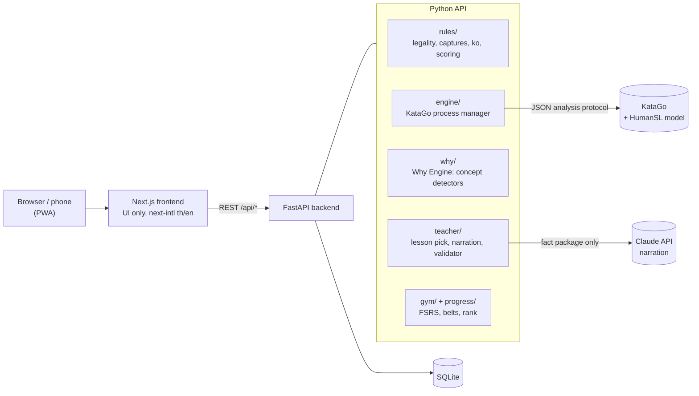

# Ishi — an AI Go teacher that explains *why*

**An AI Go teacher that explains your mistakes like a human teacher would: KataGo analyses the board, Claude narrates the lesson in Thai or English.**

**Ishi** (石, "stone") teaches the board game Go (หมากล้อม / Baduk / Weiqi) to total beginners.

Strong Go AIs like KataGo can tell you *that* a move was bad, but not *why* in words a beginner understands. Chatbots explain things in friendly words, but they get Go positions wrong. Ishi joins the two without letting the chatbot make anything up:

> **KataGo finds the truth → the Why Engine turns it into facts → Claude only rewrites those facts in plain language.**

<!-- DEMO GIF: replace with a 15–30 s capture of a game ending and the lesson appearing

-->

| Play | Lesson | Progress |
|---|---|---|
| <!--  --> *screenshot coming* | <!--  --> *screenshot coming* | <!--  --> *screenshot coming* |

## Why I built it

I'm learning Go myself as a beginner. Engines told me my moves were bad but never why, and I couldn't find a teacher who worked at my level in Thai. Ishi is the teacher I wanted: one clear lesson per game, at my level, in my language.

---

## Features

A daily session takes about 20 minutes:

1. **Warm-up.** Puzzles made from *your own* past mistakes. A spaced-repetition scheduler (FSRS) brings each one back just before you forget it.
2. **Play.** A 9×9 game against a bot that plays **like a human at your level**, not like a superhuman AI. It uses KataGo's HumanSL model and adapts to your recent results.
3. **Lesson.** After the game Ishi picks **one** mistake you are ready to learn from, explains it, then lets you replay the critical moment.

Also:
- **Rules school** (10 lessons) and a **Capture Go** mini game for complete beginners.
- **In-game nudges.** Before you confirm a big blunder, the teacher asks a question instead of giving the answer (at most 2 per game).
- **Belts and exams** from White to Brown, plus a **rank estimate** that tracks progress over time.
- **Bilingual.** Thai and English everywhere, switchable at any time.
- **Installable PWA.** Runs on your phone, with the engine on a home PC.

---

## Architecture



### Key design decisions

**1. The language model never judges the board.**
It never decides which move is good, whether a group is alive or what to play. It receives a small "fact package" from the Why Engine and only turns it into friendly sentences. If a fact is not in the package, the model may not say it.

**2. Every AI sentence is checked before you see it.**
A validator rejects the narration if it mentions a coordinate or Go concept that isn't in the facts, invents a number, gives away a puzzle answer, or uses the wrong language. A rejected narration falls back to a hand-written template, so a lesson never fails. On a 30-case evaluation set the reject rate is about 3% (target: under 10%).

**3. The Why Engine is deterministic.**
Six detectors turn KataGo's numbers into named mistakes: missed capture, ignored atari, self-atari, ladder, cut/disconnect, group death. The ladder detector reads the chase out itself. The detectors are pinned by **62 golden test positions**, many taken from real games.

**4. Only teach what the learner is ready for.**
A rank-aware filter skips mistakes above your level. A 25k player isn't taught 12k ideas, and gets one lesson per game, never a list of 15 errors.

**5. Rank is estimated from *how* you play, not only whether you win.**
Each game is scored under five human-like profiles (20k → 1d) and combined with results. In simulation against the adaptive bot, the estimate landed within about 1 stone of the true level for 26k, 22k, 15k and 10k players.

**6. Decisions are written down.**
[`docs/13-decisions.md`](docs/13-decisions.md) records 68 design decisions with dates, reasons and rejected alternatives.

### Numbers

| | |
|---|---|
| Backend tests | 826 (pytest, incl. golden positions) + 4 that need the real engine |
| Frontend tests | 20 (vitest) + TypeScript strict + ESLint |
| Lesson ready after a game | ~3.5 s with real engine + Claude |
| Nudge check latency | p95 1.04 s |
| Seed puzzles | 103 across 6 concepts |

---

## Tech stack

| Layer | Tools |
|---|---|
| Frontend | Next.js 16 (App Router), React 19, TypeScript strict, Tailwind 4, next-intl, Serwist (PWA), vitest |
| Backend | Python 3.12, FastAPI, Pydantic v2, SQLModel + SQLite, Alembic, `uv`, pytest, ruff |
| Engines | [KataGo](https://github.com/lightvector/KataGo) analysis engine + HumanSL network; Claude (Haiku) for narration |

---

## Run it locally

### Prerequisites

- A GPU that runs KataGo (developed on Windows 11 with an NVIDIA card, OpenCL build)
- Python 3.12 and [`uv`](https://docs.astral.sh/uv/)
- Node 20+ and [`pnpm`](https://pnpm.io/) 10
- Optional: an [Anthropic API key](https://console.anthropic.com/). Without it, lessons use the built-in templates.

### 1. Get KataGo and the networks

**Windows (automatic):**

```powershell
powershell -ExecutionPolicy Bypass -File scripts\setup_engine.ps1
```

This downloads KataGo v1.18.1 (OpenCL), the main `kata1-b18c384nbt` network and the `b18c384nbt-humanv0` HumanSL network into `engine/` (git-ignored), runs the benchmark, writes `engine/analysis.cfg`, and writes the `ISHI_KATAGO_*` lines into `.env`.

**macOS / Linux (manual, untested):** download a KataGo build for your platform from the [KataGo releases](https://github.com/lightvector/KataGo/releases), a `kata1-b18c384nbt` network from [katagotraining.org](https://katagotraining.org/networks/), and `b18c384nbt-humanv0.bin.gz` from the KataGo v1.15.0 release. Create an analysis config (start from KataGo's `analysis_example.cfg`), then fill in the paths in `.env`.

### 2. Configure

```powershell
copy .env.example .env      # macOS/Linux: cp .env.example .env
```

| Variable | Required | Purpose |
|---|---|---|
| `ISHI_KATAGO_BIN`, `ISHI_KATAGO_MODEL`, `ISHI_KATAGO_CONFIG` | yes | KataGo binary, main network, analysis config |
| `ISHI_KATAGO_HUMAN_MODEL` | recommended | HumanSL network for human-like bots |
| `ANTHROPIC_API_KEY` | no | Enables Claude narration |
| `ISHI_LLM_ENABLED` | no | `false` forces template lessons |
| `ISHI_LLM_MODEL` | no | Claude model id (default `claude-haiku-5-5`) |
| `ISHI_DEFAULT_LOCALE` | no | `th` (default) or `en` |
| `ISHI_DB_PATH` | no | SQLite file (default `data/ishi.db`) |

If you ran `setup_engine.ps1` first, it keeps your other `.env` lines and only rewrites the KataGo paths.

### 3. Run

**One command (Windows):**

```powershell
powershell -ExecutionPolicy Bypass -File scripts\start.ps1        # production build, API :8000 + web :3000
powershell -ExecutionPolicy Bypass -File scripts\start.ps1 -Dev   # hot reload
```

**Or run each side yourself (any OS):**

```bash
cd apps/api
uv sync
uv run uvicorn ishi.main:app --host 127.0.0.1 --port 8000 --reload
```

```bash
cd apps/web
pnpm install
pnpm dev                     # proxies /api to ISHI_API_URL (default http://127.0.0.1:8000)
```

Open http://localhost:3000. `http://localhost:3000/api/health` should report `"engine":"ok"`. The database is created on first start. To install it as an app, use the browser's "Install app" button.

### Tests and lint

```bash
cd apps/api && uv run ruff check . && uv run pytest     # add -m engine for tests that need KataGo
cd apps/web && pnpm lint && pnpm typecheck && pnpm test && pnpm build
```

The web app's API types are generated from the backend's OpenAPI schema (`apps/api/openapi.json` → `pnpm gen:api`), never hand-written.

---

## Project structure

```
apps/
  api/                 FastAPI backend
    ishi/
      rules/           Go rules engine (source of truth for legality and scoring)
      engine/          KataGo process manager
      why/             Why Engine + concept detectors
      teacher/         lesson selection, prompts, narration validator, templates
      bots/ play/      human-like bots, game flow, nudges
      gym/ school/     puzzles + FSRS, rules school
      progress/        belts, exams, rank estimate
      api/ db/         HTTP routes, SQLModel tables + Alembic migrations
    tests/             unit tests, golden positions, teacher eval set
  web/                 Next.js PWA (app/[locale]/…, components/, messages/th.json + en.json)
content/               lessons and seed puzzles (YAML/JSON)
docs/                  product spec, architecture, decisions log
scripts/               engine setup, start script, calibration and eval tools
engine/                KataGo + networks (downloaded, git-ignored)
```

---

## How I built it

I designed Ishi and worked like a tech lead: I wrote the product plan, curriculum and the rules the AI must follow (`docs/01`–`docs/12`), split the work into milestones with acceptance tests ([`docs/10-roadmap.md`](docs/10-roadmap.md)), and made the product calls recorded in the decisions log. **Most of the code was written by Claude Code** working from those specs. A milestone only counted as done when its tests and measured targets passed.

The main lesson: with an AI coding agent, most of the work is in the spec, the guardrails and the testing, not the typing.

---

## Known limitations

- **9×9 only.** 13×13 and 19×19 are not supported yet.
- **Needs a local GPU** for KataGo; there is no hosted version.
- **Setup is scripted for Windows only.** macOS/Linux need the manual engine setup above and haven't been tested.
- **Single user, no accounts.** Every table has a `user_id`, but there is no auth.
- Lessons only cover the six detected concepts; mistakes outside them aren't explained yet.
- No browser end-to-end tests yet.

## Roadmap

- Playwright tests for the main flows
- 13×13, then 19×19
- "Weakness DNA": a skill radar built from your tagged mistakes
- A hosted version so Thai school Go clubs can use it without a GPU

---

## License and credits

[MIT](LICENSE). KataGo is by David J. Wu (lightvector) and contributors, MIT-licensed; its networks are downloaded from the KataGo project and are not included in this repo. Thai Go terms follow [`docs/12-glossary.md`](docs/12-glossary.md).
