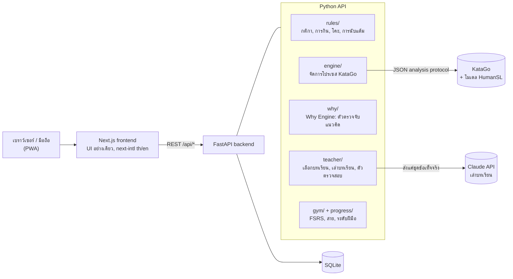

<div align="center">


<h1>Ishi 石</h1>

<p><b>ครู AI สอนหมากล้อมที่อธิบายว่าเราเดินพลาดตรงไหนและเพราะอะไร เหมือนครูที่เป็นคนจริง ๆ</b></p>

<p>KataGo วิเคราะห์กระดาน ส่วน Claude เล่าบทเรียนให้ฟังเป็นภาษาไทยหรืออังกฤษ</p>

<p>
  <a href="https://github.com/zoj33e/ishi/actions/workflows/ci.yml"></a>
  
  
  
  <a href="LICENSE"></a>
</p>

<p>
  <a href="#features">ฟีเจอร์</a> ·
  <a href="#architecture">สถาปัตยกรรม</a> ·
  <a href="#run-it-locally">ลองรันเอง</a> ·
  <a href="README.md">English</a>
</p>

</div>

<!-- GIF สาธิต: เอาคอมเมนต์ออกเมื่อมีไฟล์ docs/media/demo.gif แล้ว (ดู docs/media/README.md)
<p align="center"></p>
-->

<!-- ภาพหน้าจอ: เอาคอมเมนต์ออกเมื่อมีไฟล์ PNG แล้ว (ดู docs/media/README.md)
| เล่น | บทเรียน | ความก้าวหน้า |
|---|---|---|
|  |  |  |
-->

**Ishi** (石 แปลว่า "หิน" หรือเม็ดหมาก) สอนหมากล้อม (Go / Baduk / Weiqi) ให้คนที่ไม่เคยเล่นมาก่อนเลย

AI หมากล้อมเก่ง ๆ อย่าง KataGo บอกได้ว่าตาไหน *แย่* แต่บอกไม่ได้ว่า *ทำไม* ในภาษาที่มือใหม่เข้าใจ ส่วนแชตบอตอธิบายเป็นภาษาที่เป็นกันเองได้ แต่มักอ่านกระดานผิด Ishi เอาสองอย่างนี้มารวมกัน โดยไม่ปล่อยให้แชตบอตแต่งอะไรขึ้นมาเอง:

> **KataGo หาความจริง → Why Engine แปลงเป็นข้อเท็จจริง → Claude แค่เรียบเรียงข้อเท็จจริงนั้นใหม่ให้อ่านง่าย**

<a name="why-i-built-it"></a>
## ทำไมถึงสร้าง Ishi

ผมเองก็เป็นมือใหม่ที่กำลังหัดหมากล้อมอยู่ เอนจินบอกผมได้ว่าตาไหนเดินไม่ดี แต่ไม่เคยบอกว่าทำไม และผมก็หาครูที่สอนในระดับของผมเป็นภาษาไทยไม่ได้ Ishi คือครูที่ผมอยากได้: หนึ่งบทเรียนที่ชัดเจนต่อหนึ่งเกม ตรงกับระดับฝีมือ และเป็นภาษาของผมเอง

<a name="by-the-numbers"></a>
## ตัวเลขสำคัญ

| | |
|---|---|
| เทสต์ฝั่ง backend | 826 (pytest รวมโพสิชันอ้างอิง) + อีก 4 ที่ต้องใช้เอนจินจริง |
| เทสต์ฝั่ง frontend | 20 (vitest) + TypeScript strict + ESLint |
| เวลาจนบทเรียนพร้อมหลังจบเกม | ~3.5 วินาที เมื่อใช้เอนจินจริง + Claude |
| เวลาตรวจก่อนเตือนระหว่างเกม | p95 1.04 วินาที |
| โจทย์ตั้งต้น | 103 ข้อ ใน 6 หัวข้อ |

---

<a name="features"></a>
## ฟีเจอร์

หนึ่งเซสชันต่อวันใช้เวลาประมาณ 20 นาที:

1. **อุ่นเครื่อง** แก้โจทย์ที่สร้างจากตาที่ *เราเอง* เคยเดินพลาด ระบบทบทวนแบบเว้นระยะ (FSRS) จะเอาแต่ละข้อกลับมาให้ทำก่อนที่เราจะลืม
2. **เล่น** เกม 9×9 กับบอทที่เล่น **เหมือนคนที่ฝีมือระดับเดียวกับเรา** ไม่ใช่ AI ระดับเหนือมนุษย์ บอทใช้โมเดล HumanSL ของ KataGo และปรับตัวตามผลการเล่นล่าสุดของเรา
3. **บทเรียน** หลังจบเกม Ishi เลือกจุดพลาด **หนึ่งจุด** ที่เราพร้อมจะเรียนรู้ อธิบายให้ฟัง แล้วให้เราลองเล่นจังหวะสำคัญนั้นใหม่ด้วยตัวเอง

นอกจากนี้ยังมี:
- **โรงเรียนกติกา** (10 บท) และมินิเกม **โกะแบบกิน** (ใครกินก่อนชนะ) สำหรับคนที่เพิ่งเริ่มจริง ๆ
- **ครูเตือนระหว่างเกม** ก่อนที่เราจะยืนยันตาที่พลาดหนัก ครูจะถามคำถามให้คิดแทนการบอกคำตอบ (ไม่เกิน 2 ครั้งต่อเกม)
- **สายและการสอบ** ตั้งแต่สายขาวถึงสายน้ำตาล พร้อม **ระดับฝีมือโดยประมาณ** (คิว / ดั้ง) ที่ติดตามพัฒนาการตลอดเวลา
- **สองภาษา** ไทยและอังกฤษทุกหน้าจอ สลับได้ตลอด
- **ติดตั้งเป็นแอปได้ (PWA)** เล่นบนมือถือ โดยให้เอนจินรันอยู่บนคอมที่บ้าน

---

<a name="architecture"></a>
## สถาปัตยกรรม



### หลักการออกแบบสำคัญ

**1. โมเดลภาษาไม่เคยตัดสินกระดาน**
มันไม่เคยตัดสินว่าตาไหนดี กลุ่มหมากไหนรอดหรือตาย หรือควรเดินตรงไหน มันได้รับ "ชุดข้อเท็จจริง" เล็ก ๆ จาก Why Engine แล้วแค่เรียบเรียงเป็นประโยคที่อ่านง่าย อะไรที่ไม่อยู่ในชุดข้อเท็จจริง โมเดลห้ามพูด

**2. ทุกประโยคจาก AI ถูกตรวจก่อนถึงมือผู้เรียน**
ตัวตรวจสอบจะปฏิเสธคำอธิบาย ถ้ามันพูดถึงพิกัดหรือแนวคิดหมากล้อมที่ไม่อยู่ในข้อเท็จจริง แต่งตัวเลขขึ้นมาเอง เฉลยคำตอบของโจทย์ หรือใช้ภาษาผิด คำอธิบายที่ถูกปฏิเสธจะถูกแทนด้วยเทมเพลตที่เขียนไว้ล่วงหน้า บทเรียนจึงไม่มีวันล้ม จากชุดทดสอบ 30 กรณี อัตราการปฏิเสธอยู่ที่ประมาณ 3% (เป้าหมาย: ต่ำกว่า 10%)

**3. Why Engine ทำงานแบบตายตัว ไม่ใช่การเดาของ AI**
ตัวตรวจจับ 6 ตัวแปลงตัวเลขจาก KataGo เป็นชื่อความผิดพลาด: พลาดการกิน, ไม่หนีอาตาริ, ทำตัวเองให้ติดอาตาริ, บันได, การตัด / หมากขาดการเชื่อม และกลุ่มหมากตาย ตัวตรวจจับบันไดอ่านการไล่บันไดเองจนสุด ตัวตรวจจับทั้งหมดถูกยึดไว้ด้วย **โพสิชันอ้างอิง 62 โพสิชัน** ซึ่งหลายโพสิชันมาจากเกมจริง

**4. สอนเฉพาะสิ่งที่ผู้เรียนพร้อม**
ตัวกรองตามระดับฝีมือจะข้ามจุดพลาดที่สูงเกินระดับของเรา ผู้เล่น 25 คิวจะไม่ถูกสอนแนวคิดระดับ 12 คิว และได้หนึ่งบทเรียนต่อเกม ไม่ใช่รายการจุดพลาด 15 ข้อ

**5. ประเมินระดับฝีมือจาก *วิธี* เล่น ไม่ใช่แค่ผลแพ้ชนะ**
แต่ละเกมถูกให้คะแนนเทียบกับโปรไฟล์ผู้เล่นแบบมนุษย์ 5 ระดับ (20 คิว → 1 ดั้ง) แล้วรวมกับผลการแข่ง ในการจำลองเล่นกับบอทที่ปรับระดับเองได้ ค่าประมาณคลาดจากระดับจริงไม่เกินราว 1 หมาก สำหรับผู้เล่นระดับ 26, 22, 15 และ 10 คิว

**6. ทุกการตัดสินใจถูกบันทึกไว้**
[`docs/13-decisions.md`](docs/13-decisions.md) บันทึกการตัดสินใจด้านการออกแบบ 68 ข้อ พร้อมวันที่ เหตุผล และทางเลือกที่ไม่ได้เลือก

---

<a name="tech-stack"></a>
## เทคโนโลยีที่ใช้

| ส่วน | เครื่องมือ |
|---|---|
| Frontend | Next.js 16 (App Router), React 19, TypeScript strict, Tailwind 4, next-intl, Serwist (PWA), vitest |
| Backend | Python 3.12, FastAPI, Pydantic v2, SQLModel + SQLite, Alembic, `uv`, pytest, ruff |
| เอนจิน | [KataGo](https://github.com/lightvector/KataGo) analysis engine + เน็ตเวิร์ก HumanSL; Claude (Haiku) สำหรับเล่าบทเรียน |

---

<a name="run-it-locally"></a>
## ลองรันบนเครื่องตัวเอง

### สิ่งที่ต้องมี

> [!NOTE]
> KataGo ต้องใช้การ์ดจอ Ishi พัฒนาบน Windows 11 กับการ์ด NVIDIA (KataGo รุ่น OpenCL)

- Python 3.12 และ [`uv`](https://docs.astral.sh/uv/)
- Node 20 ขึ้นไป และ [`pnpm`](https://pnpm.io/) 10
- ไม่บังคับ: [Anthropic API key](https://console.anthropic.com/)

### 1. ติดตั้ง KataGo และเน็ตเวิร์ก

> [!NOTE]
> สคริปต์ติดตั้งใช้ได้บน Windows เท่านั้น บน macOS หรือ Linux ให้ทำตามขั้นตอนแบบแมนนวลด้านล่าง (ยังไม่ได้ทดสอบ)

```powershell
powershell -ExecutionPolicy Bypass -File scripts\setup_engine.ps1
```

สคริปต์นี้จะดาวน์โหลด KataGo v1.18.1 (OpenCL), เน็ตเวิร์กหลัก `kata1-b18c384nbt` และเน็ตเวิร์ก HumanSL `b18c384nbt-humanv0` ไปไว้ใน `engine/` (ไม่ถูก commit) รันเบนช์มาร์ก เขียนไฟล์ `engine/analysis.cfg` และเขียนบรรทัด `ISHI_KATAGO_*` ลงใน `.env`

<details>
<summary><b>macOS / Linux: ติดตั้งเอนจินแบบแมนนวล</b></summary>

ดาวน์โหลด KataGo สำหรับระบบของคุณจาก [KataGo releases](https://github.com/lightvector/KataGo/releases), เน็ตเวิร์ก `kata1-b18c384nbt` จาก [katagotraining.org](https://katagotraining.org/networks/) และ `b18c384nbt-humanv0.bin.gz` จาก release v1.15.0 ของ KataGo สร้างไฟล์ config สำหรับ analysis (เริ่มจาก `analysis_example.cfg` ของ KataGo) แล้วใส่พาธทั้งหมดลงใน `.env`

</details>

### 2. ตั้งค่า

```powershell
copy .env.example .env      # macOS/Linux: cp .env.example .env
```

> [!TIP]
> Ishi ใช้งานได้แม้ไม่มี Anthropic API key บทเรียนจะใช้เทมเพลตที่เขียนไว้ในตัวแทน Claude

ถ้ารัน `setup_engine.ps1` ก่อนแล้ว สคริปต์จะเก็บบรรทัดอื่นใน `.env` ไว้ และเขียนทับเฉพาะพาธของ KataGo

<details>
<summary><b>ตัวแปรสภาพแวดล้อม</b></summary>

| ตัวแปร | จำเป็น | ใช้ทำอะไร |
|---|---|---|
| `ISHI_KATAGO_BIN`, `ISHI_KATAGO_MODEL`, `ISHI_KATAGO_CONFIG` | ใช่ | ไฟล์ KataGo, เน็ตเวิร์กหลัก, config ของ analysis |
| `ISHI_KATAGO_HUMAN_MODEL` | แนะนำ | เน็ตเวิร์ก HumanSL สำหรับบอทที่เล่นเหมือนคน |
| `ANTHROPIC_API_KEY` | ไม่ | เปิดให้ Claude เล่าบทเรียน |
| `ISHI_LLM_ENABLED` | ไม่ | `false` = บังคับใช้บทเรียนแบบเทมเพลต |
| `ISHI_LLM_MODEL` | ไม่ | รหัสโมเดล Claude (ค่าเริ่มต้น `claude-haiku-5-5`) |
| `ISHI_DEFAULT_LOCALE` | ไม่ | `th` (ค่าเริ่มต้น) หรือ `en` |
| `ISHI_DB_PATH` | ไม่ | ไฟล์ SQLite (ค่าเริ่มต้น `data/ishi.db`) |

</details>

### 3. รัน

**คำสั่งเดียว (Windows):**

```powershell
powershell -ExecutionPolicy Bypass -File scripts\start.ps1        # production build, API :8000 + web :3000
powershell -ExecutionPolicy Bypass -File scripts\start.ps1 -Dev   # hot reload
```

**หรือรันแต่ละฝั่งเอง (ทุกระบบปฏิบัติการ):**

```bash
cd apps/api
uv sync
uv run uvicorn ishi.main:app --host 127.0.0.1 --port 8000 --reload
```

```bash
cd apps/web
pnpm install
pnpm dev                     # proxies /api to ISHI_API_URL (default http://127.0.0.1:8000)
```

เปิด http://localhost:3000 แล้ว `http://localhost:3000/api/health` ควรแสดง `"engine":"ok"` ฐานข้อมูลจะถูกสร้างตอนรันครั้งแรก ถ้าอยากติดตั้งเป็นแอป ให้กดปุ่ม "Install app" ของเบราว์เซอร์

<details>
<summary><b>เทสต์และ lint</b></summary>

```bash
cd apps/api && uv run ruff check . && uv run pytest     # add -m engine for tests that need KataGo
cd apps/web && pnpm lint && pnpm typecheck && pnpm test && pnpm build
```

type ของ API ฝั่งเว็บสร้างจาก OpenAPI schema ของ backend (`apps/api/openapi.json` → `pnpm gen:api`) ไม่ได้เขียนเอง

</details>

---

<a name="project-structure"></a>
## โครงสร้างโปรเจกต์

<details>
<summary><b>โครงสร้างโฟลเดอร์</b></summary>

```
apps/
  api/                 FastAPI backend
    ishi/
      rules/           Go rules engine (source of truth for legality and scoring)
      engine/          KataGo process manager
      why/             Why Engine + concept detectors
      teacher/         lesson selection, prompts, narration validator, templates
      bots/ play/      human-like bots, game flow, nudges
      gym/ school/     puzzles + FSRS, rules school
      progress/        belts, exams, rank estimate
      api/ db/         HTTP routes, SQLModel tables + Alembic migrations
    tests/             unit tests, golden positions, teacher eval set
  web/                 Next.js PWA (app/[locale]/…, components/, messages/th.json + en.json)
content/               lessons and seed puzzles (YAML/JSON)
docs/                  product spec, architecture, decisions log
scripts/               engine setup, start script, calibration and eval tools
engine/                KataGo + networks (downloaded, git-ignored)
```

</details>

---

<a name="how-i-built-it"></a>
## สร้างขึ้นมาอย่างไร

ผมออกแบบ Ishi และทำงานในบทบาทแบบ tech lead: เขียนแผนผลิตภัณฑ์ หลักสูตร และกฎที่ AI ต้องปฏิบัติตาม (`docs/01`–`docs/12`) แบ่งงานเป็น milestone ที่มีเกณฑ์การรับงานชัดเจน ([`docs/10-roadmap.md`](docs/10-roadmap.md)) และตัดสินใจด้านผลิตภัณฑ์ที่บันทึกไว้ใน decisions log **โค้ดส่วนใหญ่เขียนโดย Claude Code** ตามสเปกเหล่านั้น แต่ละ milestone จะนับว่าเสร็จก็ต่อเมื่อเทสต์และตัวเลขที่วัดได้ผ่านเป้า

บทเรียนหลักที่ได้: เวลาทำงานกับ AI coding agent งานส่วนใหญ่อยู่ที่สเปก การวางกรอบ และการทดสอบ ไม่ใช่การพิมพ์โค้ด

---

<a name="known-limitations"></a>
## ข้อจำกัดที่รู้อยู่

- **กระดาน 9×9 เท่านั้น** ยังไม่รองรับ 13×13 และ 19×19
- **ต้องมีการ์ดจอในเครื่อง** สำหรับ KataGo ยังไม่มีเวอร์ชันออนไลน์
- **สคริปต์ติดตั้งมีแค่สำหรับ Windows** macOS/Linux ต้องติดตั้งเอนจินเองตามขั้นตอนด้านบน และยังไม่ได้ทดสอบ
- **ผู้ใช้คนเดียว ไม่มีระบบบัญชี** ทุกตารางมี `user_id` แต่ยังไม่มีระบบยืนยันตัวตน
- บทเรียนครอบคลุมแค่ 6 แนวคิดที่ตรวจจับได้ จุดพลาดนอกเหนือจากนั้นยังไม่มีคำอธิบาย
- ยังไม่มีเทสต์ end-to-end บนเบราว์เซอร์

<a name="roadmap"></a>
## แผนต่อไป

- เทสต์ Playwright สำหรับ flow หลัก
- 13×13 แล้วตามด้วย 19×19
- "Weakness DNA": กราฟเรดาร์จุดอ่อนที่สร้างจากจุดพลาดที่ถูกติดแท็กไว้
- เวอร์ชันออนไลน์ เพื่อให้ชมรมหมากล้อมในโรงเรียนไทยใช้ได้โดยไม่ต้องมีการ์ดจอ

---

<a name="license-and-credits"></a>
## สัญญาอนุญาตและเครดิต

[MIT](LICENSE) KataGo พัฒนาโดย David J. Wu (lightvector) และผู้ร่วมพัฒนา ใช้สัญญาอนุญาต MIT เน็ตเวิร์กของ KataGo ดาวน์โหลดจากโปรเจกต์ KataGo และไม่ได้รวมไว้ใน repo นี้ ศัพท์หมากล้อมภาษาไทยอ้างอิงจาก [`docs/12-glossary.md`](docs/12-glossary.md)
